<div align="center">
  
</div>

<p align="center">
  <a href="https://github.com/Ikyletwar?tab=followers"></a>
  
  <a href="https://github.com/Ikyletwar?tab=repositories"></a>
  <a href="https://github.com/Ikyletwar/Ikyletwar/actions"></a>
</p>

<p align="center">
  <!-- AUTO:STATS -->
`43 repos` · `25 live` · `0 stars` · `2 forks` · `139 contributions/12mo` · `3d streak`

**C** 63% · **C++** 25% · **HTML** 6% · **JavaScript** 4% · **Kotlin** 1%
<!-- /AUTO:STATS -->
</p>

<div align="center">
  
</div>

---

## `/whoami --verbose`

<div align="center">
  
</div>

```yaml
name: Hizkia Letwar
handle: "@Ikyletwar"
display_name: "Nihongo-Web"
role: "XI TJKT 1 · SMK Negeri 1 Maluku Tengah"
region_context: "Maluku Tengah, Indonesia"
model: [static-first, offline-first, mobile-first, no-build-when-possible]
focus: [web & PWA, android kotlin/compose, school tooling, reverse engineering, prompt-injection research]
live_signal: "self-updating — assets regenerated daily from the GitHub API"
```

## About Me

Saya Hizkia Letwar, siswa **XI TJKT 1 di SMK Negeri 1 Maluku Tengah** — jurusan Teknik Jaringan Komputer dan Telekomunikasi. Banyak project saya berangkat dari hal yang dekat dengan sekolah dan komunitas: jadwal pelajaran, direktori guru, absensi, pencatatan pelanggaran, inventaris barang, situs kelas, dan prompt AI untuk teman-teman TJKT. Saya lebih suka membangun tool yang benar-benar dipakai daripada sekadar demo yang berhenti di localhost.

Benang merahnya adalah rasa penasaran: bagaimana sebuah sistem bekerja, bagaimana ia gagal, dan bagaimana saya bisa membuatnya lebih berguna. Itu alasan saya masuk ke web apps, PWA offline-first, Android (Kotlin/Compose/Room dan Java), reverse engineering, OSINT, dan prompt-injection research. Saya suka mulai dari problem nyata, bikin versi paling sederhana yang jalan, deploy dulu, lalu perbaiki sampai layak dipakai.

Minat yang paling sering muncul: **bahasa Jepang** (`nihongo-quest`, `nihongo-prompts`, `Nihonjin-AI`), **anime & streaming** (`zerostream`, `animehub`), **catur** (`chess-lan`), **UI premium / dark / glassmorphism** (`Luxury-ECommerce-UI`, template auth), **AI di browser** (`SeLA`, `Resep-AI`, `StoryForge-AI`), dan **keamanan aplikasi** (`jailbreak-prompt-corpus`, `szax-launcher-re`, `TatsumiLoader-MLBB`).

Cara kerja saya sederhana: **statis dulu kalau bisa, offline kalau memungkinkan, mobile-first selalu, backend hanya kalau memang perlu.** Saya nyaman dengan HTML/CSS/JavaScript murni, lalu naik ke PWA, Express/SQLite/Room, sampai native C/NDK kalau projectnya menuntut.

## Live Dashboard

<div align="center">
  
</div>

<div align="center">
  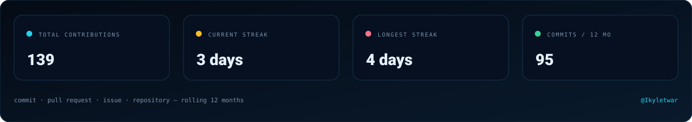
</div>

<div align="center">
  
</div>

<div align="center">
  
</div>

<p align="center"><sub>Semua grafik di atas dirender dari data publik GitHub — bukan gambar tempelan. Diperbarui otomatis tiap hari oleh <code>.github/workflows/profile.yml</code>.</sub></p>

---

## Repo Matrix — auto-generated

<p align="center"><sub><b>Legend:</b> accent bar = bahasa utama · <b style="color:#34d399">LIVE</b> = punya GitHub Pages aktif · kartu dibuat ulang dari metadata repo setiap kali workflow berjalan.</sub></p>

<!-- AUTO:CARDS -->
<table>
<tr><td width="50%" align="center" valign="top"><a href="https://github.com/Ikyletwar/putra-lordian">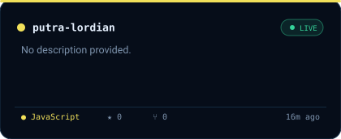</a><br><sub><a href="https://github.com/Ikyletwar/putra-lordian">Repo ↗</a> · <a href="https://ikyletwar.github.io/putra-lordian/">Live ↗</a></sub></td><td width="50%" align="center" valign="top"><a href="https://github.com/Ikyletwar/netmon">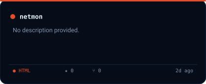</a><br><sub><a href="https://github.com/Ikyletwar/netmon">Repo ↗</a></sub></td></tr>
<tr><td width="50%" align="center" valign="top"><a href="https://github.com/Ikyletwar/exam-smkn1-malteng">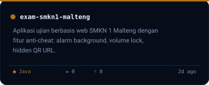</a><br><sub><a href="https://github.com/Ikyletwar/exam-smkn1-malteng">Repo ↗</a></sub></td><td width="50%" align="center" valign="top"><a href="https://github.com/Ikyletwar/natal-grabber">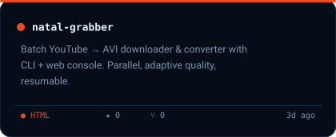</a><br><sub><a href="https://github.com/Ikyletwar/natal-grabber">Repo ↗</a></sub></td></tr>
<tr><td width="50%" align="center" valign="top"><a href="https://github.com/Ikyletwar/animehub">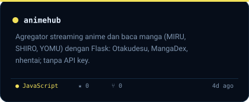</a><br><sub><a href="https://github.com/Ikyletwar/animehub">Repo ↗</a></sub></td><td width="50%" align="center" valign="top"><a href="https://github.com/Ikyletwar/MinimapViewer">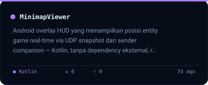</a><br><sub><a href="https://github.com/Ikyletwar/MinimapViewer">Repo ↗</a></sub></td></tr>
<tr><td width="50%" align="center" valign="top"><a href="https://github.com/Ikyletwar/szax-launcher-re">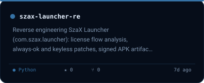</a><br><sub><a href="https://github.com/Ikyletwar/szax-launcher-re">Repo ↗</a></sub></td><td width="50%" align="center" valign="top"><a href="https://github.com/Ikyletwar/nilai-akhir-smk">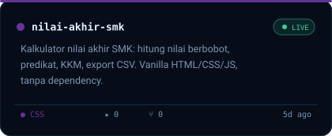</a><br><sub><a href="https://github.com/Ikyletwar/nilai-akhir-smk">Repo ↗</a> · <a href="https://ikyletwar.github.io/nilai-akhir-smk/">Live ↗</a></sub></td></tr>
<tr><td width="50%" align="center" valign="top"><a href="https://github.com/Ikyletwar/chess-lan">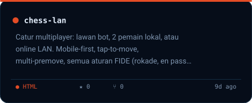</a><br><sub><a href="https://github.com/Ikyletwar/chess-lan">Repo ↗</a></sub></td><td width="50%" align="center" valign="top"><a href="https://github.com/Ikyletwar/nihongo-prompts">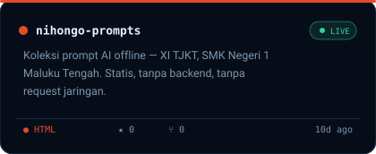</a><br><sub><a href="https://github.com/Ikyletwar/nihongo-prompts">Repo ↗</a> · <a href="https://ikyletwar.github.io/nihongo-prompts/">Live ↗</a></sub></td></tr>
<tr><td width="50%" align="center" valign="top"><a href="https://github.com/Ikyletwar/simu-web">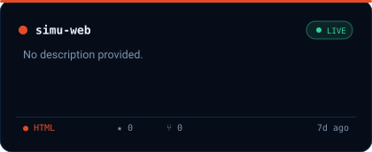</a><br><sub><a href="https://github.com/Ikyletwar/simu-web">Repo ↗</a> · <a href="https://ikyletwar.github.io/simu-web/">Live ↗</a></sub></td><td width="50%" align="center" valign="top"><a href="https://github.com/Ikyletwar/personal-website-v2">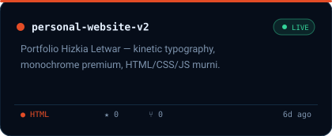</a><br><sub><a href="https://github.com/Ikyletwar/personal-website-v2">Repo ↗</a> · <a href="https://ikyletwar.github.io/personal-website-v2/">Live ↗</a></sub></td></tr>
<tr><td width="50%" align="center" valign="top"><a href="https://github.com/Ikyletwar/dih-pinterest-replica">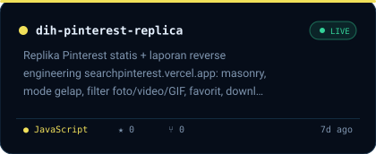</a><br><sub><a href="https://github.com/Ikyletwar/dih-pinterest-replica">Repo ↗</a> · <a href="https://ikyletwar.github.io/dih-pinterest-replica/">Live ↗</a></sub></td><td width="50%" align="center" valign="top"><a href="https://github.com/Ikyletwar/nihongo-quest">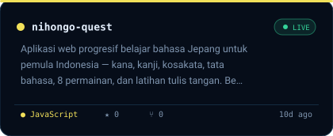</a><br><sub><a href="https://github.com/Ikyletwar/nihongo-quest">Repo ↗</a> · <a href="https://ikyletwar.github.io/nihongo-quest/">Live ↗</a></sub></td></tr>
<tr><td width="50%" align="center" valign="top"><a href="https://github.com/Ikyletwar/cool-luxe-villa">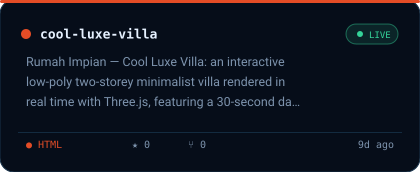</a><br><sub><a href="https://github.com/Ikyletwar/cool-luxe-villa">Repo ↗</a> · <a href="https://ikyletwar.github.io/cool-luxe-villa/">Live ↗</a></sub></td><td width="50%" align="center" valign="top"><a href="https://github.com/Ikyletwar/scraping-dan-cloningan-ujian-online">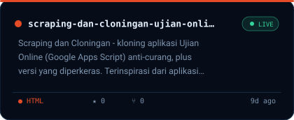</a><br><sub><a href="https://github.com/Ikyletwar/scraping-dan-cloningan-ujian-online">Repo ↗</a> · <a href="https://ikyletwar.github.io/scraping-dan-cloningan-ujian-online/">Live ↗</a></sub></td></tr>
<tr><td width="50%" align="center" valign="top"><a href="https://github.com/Ikyletwar/SimpleMusicPlayer">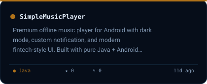</a><br><sub><a href="https://github.com/Ikyletwar/SimpleMusicPlayer">Repo ↗</a></sub></td><td width="50%" align="center" valign="top"><a href="https://github.com/Ikyletwar/AutoJadwal-SMKN1">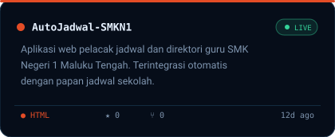</a><br><sub><a href="https://github.com/Ikyletwar/AutoJadwal-SMKN1">Repo ↗</a> · <a href="https://ikyletwar.github.io/AutoJadwal-SMKN1/">Live ↗</a></sub></td></tr>
<tr><td width="50%" align="center" valign="top"><a href="https://github.com/Ikyletwar/tiktok-scraper">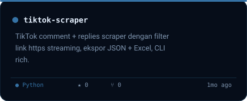</a><br><sub><a href="https://github.com/Ikyletwar/tiktok-scraper">Repo ↗</a></sub></td><td width="50%" align="center" valign="top"><a href="https://github.com/Ikyletwar/TatsumiLoader-MLBB">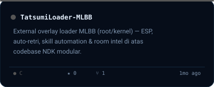</a><br><sub><a href="https://github.com/Ikyletwar/TatsumiLoader-MLBB">Repo ↗</a></sub></td></tr>
<tr><td width="50%" align="center" valign="top"><a href="https://github.com/Ikyletwar/jailbreak-prompt-corpus">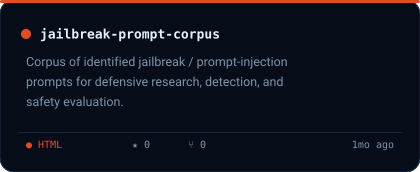</a><br><sub><a href="https://github.com/Ikyletwar/jailbreak-prompt-corpus">Repo ↗</a></sub></td><td width="50%" align="center" valign="top"><a href="https://github.com/Ikyletwar/computerclass">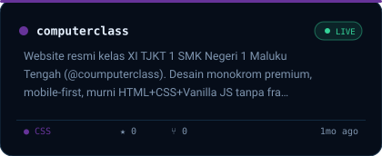</a><br><sub><a href="https://github.com/Ikyletwar/computerclass">Repo ↗</a> · <a href="https://ikyletwar.github.io/computerclass/">Live ↗</a></sub></td></tr>
<tr><td width="50%" align="center" valign="top"><a href="https://github.com/Ikyletwar/school-inventory">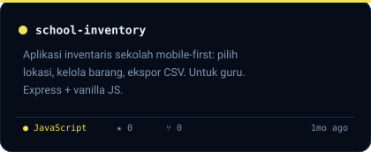</a><br><sub><a href="https://github.com/Ikyletwar/school-inventory">Repo ↗</a></sub></td><td width="50%" align="center" valign="top"><a href="https://github.com/Ikyletwar/absensi-late-smpn38">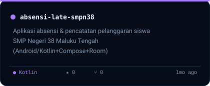</a><br><sub><a href="https://github.com/Ikyletwar/absensi-late-smpn38">Repo ↗</a></sub></td></tr>
<tr><td width="50%" align="center" valign="top"><a href="https://github.com/Ikyletwar/rupiahs-hunters">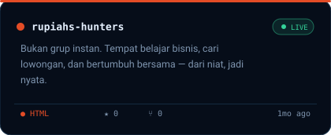</a><br><sub><a href="https://github.com/Ikyletwar/rupiahs-hunters">Repo ↗</a> · <a href="https://ikyletwar.github.io/rupiahs-hunters/">Live ↗</a></sub></td><td width="50%" align="center" valign="top"><a href="https://github.com/Ikyletwar/absensi-late-smk">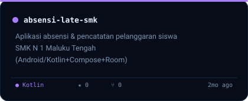</a><br><sub><a href="https://github.com/Ikyletwar/absensi-late-smk">Repo ↗</a></sub></td></tr>
<tr><td width="50%" align="center" valign="top"><a href="https://github.com/Ikyletwar/Arduino-Kejur1">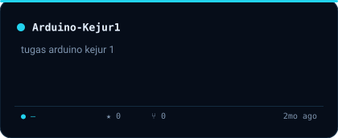</a><br><sub><a href="https://github.com/Ikyletwar/Arduino-Kejur1">Repo ↗</a></sub></td><td width="50%" align="center" valign="top"><a href="https://github.com/Ikyletwar/zerostream2">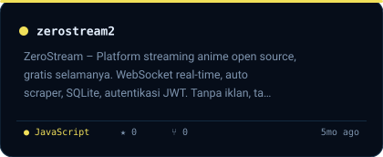</a><br><sub><a href="https://github.com/Ikyletwar/zerostream2">Repo ↗</a></sub></td></tr>
<tr><td width="50%" align="center" valign="top"><a href="https://github.com/Ikyletwar/zerostream">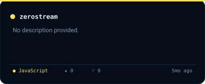</a><br><sub><a href="https://github.com/Ikyletwar/zerostream">Repo ↗</a></sub></td><td width="50%" align="center" valign="top"><a href="https://github.com/Ikyletwar/Personal-Website">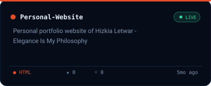</a><br><sub><a href="https://github.com/Ikyletwar/Personal-Website">Repo ↗</a> · <a href="https://ikyletwar.github.io/Personal-Website/">Live ↗</a></sub></td></tr>
<tr><td width="50%" align="center" valign="top"><a href="https://github.com/Ikyletwar/Prompt">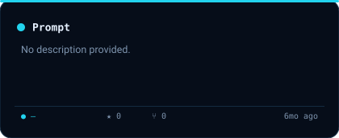</a><br><sub><a href="https://github.com/Ikyletwar/Prompt">Repo ↗</a></sub></td><td width="50%" align="center" valign="top"><a href="https://github.com/Ikyletwar/KafeElis">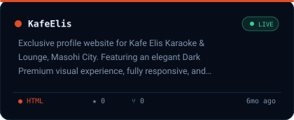</a><br><sub><a href="https://github.com/Ikyletwar/KafeElis">Repo ↗</a> · <a href="https://ikyletwar.github.io/KafeElis/">Live ↗</a></sub></td></tr>
<tr><td width="50%" align="center" valign="top"><a href="https://github.com/Ikyletwar/SIRA">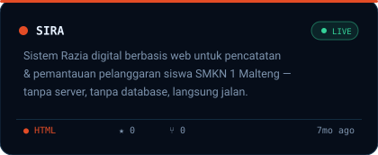</a><br><sub><a href="https://github.com/Ikyletwar/SIRA">Repo ↗</a> · <a href="https://ikyletwar.github.io/SIRA/">Live ↗</a></sub></td><td width="50%" align="center" valign="top"><a href="https://github.com/Ikyletwar/StoryForge-AI">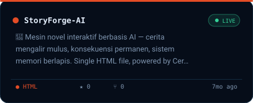</a><br><sub><a href="https://github.com/Ikyletwar/StoryForge-AI">Repo ↗</a> · <a href="https://ikyletwar.github.io/StoryForge-AI/">Live ↗</a></sub></td></tr>
<tr><td width="50%" align="center" valign="top"><a href="https://github.com/Ikyletwar/Resep-AI">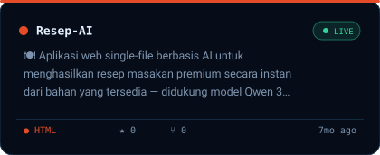</a><br><sub><a href="https://github.com/Ikyletwar/Resep-AI">Repo ↗</a> · <a href="https://ikyletwar.github.io/Resep-AI/">Live ↗</a></sub></td><td width="50%" align="center" valign="top"><a href="https://github.com/Ikyletwar/Nihonjin-AI">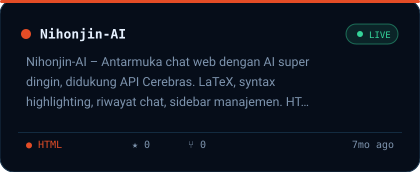</a><br><sub><a href="https://github.com/Ikyletwar/Nihonjin-AI">Repo ↗</a> · <a href="https://ikyletwar.github.io/Nihonjin-AI/">Live ↗</a></sub></td></tr>
<tr><td width="50%" align="center" valign="top"><a href="https://github.com/Ikyletwar/SeLA">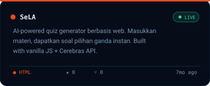</a><br><sub><a href="https://github.com/Ikyletwar/SeLA">Repo ↗</a> · <a href="https://ikyletwar.github.io/SeLA/">Live ↗</a></sub></td><td width="50%" align="center" valign="top"><a href="https://github.com/Ikyletwar/TaskFlow-ToDo">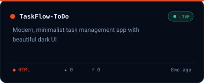</a><br><sub><a href="https://github.com/Ikyletwar/TaskFlow-ToDo">Repo ↗</a> · <a href="https://ikyletwar.github.io/TaskFlow-ToDo/">Live ↗</a></sub></td></tr>
<tr><td width="50%" align="center" valign="top"><a href="https://github.com/Ikyletwar/Luxury-ECommerce-UI">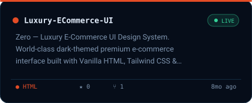</a><br><sub><a href="https://github.com/Ikyletwar/Luxury-ECommerce-UI">Repo ↗</a> · <a href="https://ikyletwar.github.io/Luxury-ECommerce-UI/">Live ↗</a></sub></td><td width="50%" align="center" valign="top"><a href="https://github.com/Ikyletwar/Template-UI-Design-2">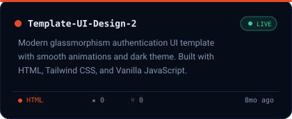</a><br><sub><a href="https://github.com/Ikyletwar/Template-UI-Design-2">Repo ↗</a> · <a href="https://ikyletwar.github.io/Template-UI-Design-2/">Live ↗</a></sub></td></tr>
<tr><td width="50%" align="center" valign="top"><a href="https://github.com/Ikyletwar/Template-UI-Design">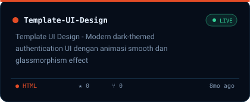</a><br><sub><a href="https://github.com/Ikyletwar/Template-UI-Design">Repo ↗</a> · <a href="https://ikyletwar.github.io/Template-UI-Design/">Live ↗</a></sub></td><td width="50%" align="center" valign="top"><a href="https://github.com/Ikyletwar/text-encoder-decoder">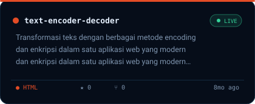</a><br><sub><a href="https://github.com/Ikyletwar/text-encoder-decoder">Repo ↗</a> · <a href="https://ikyletwar.github.io/text-encoder-decoder/">Live ↗</a></sub></td></tr>
<tr><td width="50%" align="center" valign="top"><a href="https://github.com/Ikyletwar/modern-login-ui">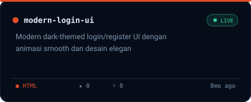</a><br><sub><a href="https://github.com/Ikyletwar/modern-login-ui">Repo ↗</a> · <a href="https://ikyletwar.github.io/modern-login-ui/">Live ↗</a></sub></td><td width="50%"></td></tr>
</table>
<!-- /AUTO:CARDS -->

---

## Live Endpoints — auto-detected

<!-- AUTO:LIVE -->
| Project | Live endpoint | Stack |
|---|---|---|
| [`AutoJadwal-SMKN1`](https://github.com/Ikyletwar/AutoJadwal-SMKN1) | <https://ikyletwar.github.io/AutoJadwal-SMKN1/> | HTML |
| [`computerclass`](https://github.com/Ikyletwar/computerclass) | <https://ikyletwar.github.io/computerclass/> | CSS |
| [`cool-luxe-villa`](https://github.com/Ikyletwar/cool-luxe-villa) | <https://ikyletwar.github.io/cool-luxe-villa/> | HTML |
| [`dih-pinterest-replica`](https://github.com/Ikyletwar/dih-pinterest-replica) | <https://ikyletwar.github.io/dih-pinterest-replica/> | JavaScript |
| [`KafeElis`](https://github.com/Ikyletwar/KafeElis) | <https://ikyletwar.github.io/KafeElis/> | HTML |
| [`Luxury-ECommerce-UI`](https://github.com/Ikyletwar/Luxury-ECommerce-UI) | <https://ikyletwar.github.io/Luxury-ECommerce-UI/> | HTML |
| [`modern-login-ui`](https://github.com/Ikyletwar/modern-login-ui) | <https://ikyletwar.github.io/modern-login-ui/> | HTML |
| [`nihongo-prompts`](https://github.com/Ikyletwar/nihongo-prompts) | <https://ikyletwar.github.io/nihongo-prompts/> | HTML |
| [`nihongo-quest`](https://github.com/Ikyletwar/nihongo-quest) | <https://ikyletwar.github.io/nihongo-quest/> | JavaScript |
| [`Nihonjin-AI`](https://github.com/Ikyletwar/Nihonjin-AI) | <https://ikyletwar.github.io/Nihonjin-AI/> | HTML |
| [`nilai-akhir-smk`](https://github.com/Ikyletwar/nilai-akhir-smk) | <https://ikyletwar.github.io/nilai-akhir-smk/> | CSS |
| [`Personal-Website`](https://github.com/Ikyletwar/Personal-Website) | <https://ikyletwar.github.io/Personal-Website/> | HTML |
| [`personal-website-v2`](https://github.com/Ikyletwar/personal-website-v2) | <https://ikyletwar.github.io/personal-website-v2/> | HTML |
| [`putra-lordian`](https://github.com/Ikyletwar/putra-lordian) | <https://ikyletwar.github.io/putra-lordian/> | JavaScript |
| [`Resep-AI`](https://github.com/Ikyletwar/Resep-AI) | <https://ikyletwar.github.io/Resep-AI/> | HTML |
| [`rupiahs-hunters`](https://github.com/Ikyletwar/rupiahs-hunters) | <https://ikyletwar.github.io/rupiahs-hunters/> | HTML |
| [`scraping-dan-cloningan-ujian-online`](https://github.com/Ikyletwar/scraping-dan-cloningan-ujian-online) | <https://ikyletwar.github.io/scraping-dan-cloningan-ujian-online/> | HTML |
| [`SeLA`](https://github.com/Ikyletwar/SeLA) | <https://ikyletwar.github.io/SeLA/> | HTML |
| [`simu-web`](https://github.com/Ikyletwar/simu-web) | <https://ikyletwar.github.io/simu-web/> | HTML |
| [`SIRA`](https://github.com/Ikyletwar/SIRA) | <https://ikyletwar.github.io/SIRA/> | HTML |
| [`StoryForge-AI`](https://github.com/Ikyletwar/StoryForge-AI) | <https://ikyletwar.github.io/StoryForge-AI/> | HTML |
| [`TaskFlow-ToDo`](https://github.com/Ikyletwar/TaskFlow-ToDo) | <https://ikyletwar.github.io/TaskFlow-ToDo/> | HTML |
| [`Template-UI-Design`](https://github.com/Ikyletwar/Template-UI-Design) | <https://ikyletwar.github.io/Template-UI-Design/> | HTML |
| [`Template-UI-Design-2`](https://github.com/Ikyletwar/Template-UI-Design-2) | <https://ikyletwar.github.io/Template-UI-Design-2/> | HTML |
| [`text-encoder-decoder`](https://github.com/Ikyletwar/text-encoder-decoder) | <https://ikyletwar.github.io/text-encoder-decoder/> | HTML |
<!-- /AUTO:LIVE -->

---

## Signature Work

| Project | Kenapa penting | Baca |
|---|---|---|
| [`nihongo-quest`](https://github.com/Ikyletwar/nihongo-quest) | Sample end-to-end terbaik: kana/kanji/kosakata/grammar, 8 game, handwriting, offline, tanpa akun. | [Live ↗](https://ikyletwar.github.io/nihongo-quest/) |
| [`TatsumiLoader-MLBB`](https://github.com/Ikyletwar/TatsumiLoader-MLBB) | Codebase NDK modular: overlay, ESP, automation, room intel. | Repo |
| [`szax-launcher-re`](https://github.com/Ikyletwar/szax-launcher-re) | Analisis alur lisensi APK, patch keyless, catatan packer, artefak signed. | Repo |
| [`chess-lan`](https://github.com/Ikyletwar/chess-lan) | Catur lengkap: bot, lokal, LAN; semua aturan FIDE, mobile-first. | Repo |
| [`cool-luxe-villa`](https://github.com/Ikyletwar/cool-luxe-villa) | Three.js realtime, siklus siang/senja/malam 30 detik, single file. | Repo |
| [`computerclass`](https://github.com/Ikyletwar/computerclass) | Situs kelas XI TJKT 1: monokrom premium, 29 siswa, jadwal, galeri. | [Live ↗](https://ikyletwar.github.io/computerclass/) |

## Stack & Tools

<div align="center">
  
</div>

| Layer | Details |
|---|---|
| Front-end | HTML, CSS, Vanilla JS, Tailwind, responsive/mobile-first, GitHub Pages, Vercel |
| App model | Static-first, PWA/offline-first, localStorage/Room, no backend unless it earns its place |
| Android | Kotlin + Compose + Room, Java + Android SDK, NDK/C research |
| AI in browser | Cerebras API workflows, bring-your-own-key SPAs, prompt engineering |
| RE / security | radare2, decompiler workflow, dynamic analysis, apktool, mitmproxy, Reqable/MT Manager |
| Data / automation | Python CLI, JSON/Excel export, scraping, Apps Script clone analysis |
| Automation | GitHub Actions + Python generator (this README is a build artifact) |

## Operating Principles

| # | Principle | In practice |
|---:|---|---|
| 1 | **Masalah dulu, solusi kemudian** | Repo berangkat dari problem nyata, bukan tutorial. |
| 2 | **Static before server** | Kalau satu file HTML cukup, ya satu file HTML. |
| 3 | **Offline kalau bisa** | PWA, localStorage, Room, prompt pack statis. |
| 4 | **Deploy cepat, lalu rapikan** | Pages/Vercel dulu, polish belakangan. |
| 5 | **Dokumentasi yang cukup** | README dengan live link, scope, dan limitasi jujur. |
| 6 | **Security with context** | RE & prompt-injection untuk belajar, evaluasi defensif, dan aset berizin. |

## Roadmap

```text
NOW   school ops tooling · PWA belajar Jepang · RE writeups · premium vanilla UI
NEXT  README yang lebih tajam · empty-state data · performance pass · Android/Compose depth
RULE  bikin sampai jalan dulu, lalu perbaiki sampai layak dipakai
```

## Contact

<p align="center">
  <a href="https://github.com/Ikyletwar"></a>
  <a href="https://ikyletwar.github.io/personal-website-v2/"></a>
  <a href="https://ikyletwar.github.io/nihongo-quest/"></a>
</p>

---

<details>
<summary><b>⚙️ Bagaimana README ini auto-update?</b></summary>

<br />

README ini adalah **artefak build**, bukan dokumen manual.

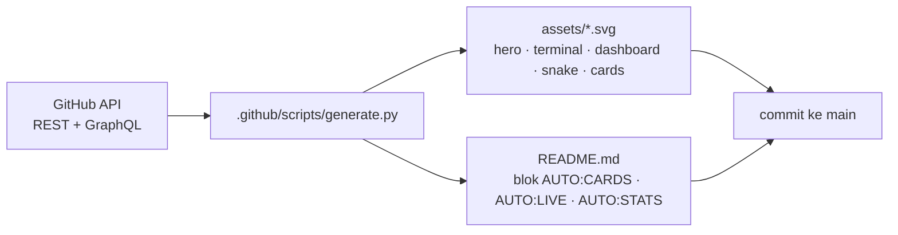

- **Trigger:** jadwal harian (`cron`), push ke `main`, dan `workflow_dispatch`.
- **Auto-detect:** repo baru, deskripsi, bahasa utama (via bytes), stars/forks, GitHub Pages aktif (`/pages` API), dan tanggal push terakhir.
- **Auto-animate:** semua SVG memakai animasi native (SMIL/CSS) — tidak butuh JavaScript, tetap hidup di `` GitHub.
- **Adaptif:** layout responsif 100% lebar, palet gelap yang konsisten, fallback teks untuk pembaca layar.

</details>

<!-- AUTO:STAMP -->
`last sync 2026-11-10 09:57 UTC`
<!-- /AUTO:STAMP -->

<div align="center">
  
</div>
