  

  <a href="https://github.com/Ikyletwar">GitHub</a> &nbsp;·&nbsp;
  <a href="https://ikyletwar.github.io/personal-website-v2/">Portfolio</a> &nbsp;·&nbsp;
  <a href="https://ikyletwar.github.io/nihongo-quest/">Nihongo Quest</a>

> Saya membangun alat kecil yang benar-benar dipakai. Kalau satu file HTML cukup, satu file HTML yang saya kirim.

## 01 — Profil

Saya siswa XI TJKT 1 di SMK Negeri 1 Maluku Tengah, jurusan Teknik Jaringan Komputer dan Telekomunikasi. Sebagian besar project saya lahir dari kebutuhan di sekitar sekolah: jadwal pelajaran, direktori guru, absensi, pencatatan pelanggaran, inventaris barang, dan materi AI untuk teman-teman TJKT.

Benang merahnya sederhana: paham masalahnya, buat versi paling kecil yang jalan, deploy, lalu rapikan sampai layak dipakai. Saya nyaman dengan HTML/CSS/JavaScript murni, lalu naik ke PWA, Express/SQLite/Room, atau C/NDK kalau projectnya menuntut.

Minat lain yang sering muncul: bahasa Jepang, anime dan streaming, catur, antarmuka monokrom, AI di browser, serta analisis keamanan aplikasi.

**Sekarang** — school ops tooling, PWA belajar Jepang, catatan reverse engineering, dan UI vanilla yang rapi.  
**Selanjutnya** — pendalaman Android/Compose, empty-state data, dan performance pass.

 

## 02 — Karya Pilihan

| Project | Ringkasan | Tautan |
|---|---|---|
| `nihongo-quest` | PWA belajar Jepang offline: kana, kanji, kosakata, grammar, delapan game, dan latihan tulis tangan. | [repo](https://github.com/Ikyletwar/nihongo-quest) · [live](https://ikyletwar.github.io/nihongo-quest/) |
| `open-motion` | Editor timeline motion graphics di browser, modular, jalan langsung tanpa build step. | [repo](https://github.com/Ikyletwar/open-motion) · [live](https://ikyletwar.github.io/open-motion/) |
| `computerclass` | Situs kelas XI TJKT 1: monokrom, 29 siswa, jadwal, galeri, dan profil creator. | [repo](https://github.com/Ikyletwar/computerclass) · [live](https://ikyletwar.github.io/computerclass/) |
| `AutoJadwal-SMKN1` | Pelacak jadwal dan direktori guru yang terhubung dengan papan jadwal sekolah. | [repo](https://github.com/Ikyletwar/AutoJadwal-SMKN1) · [live](https://ikyletwar.github.io/AutoJadwal-SMKN1/) |
| `nilai-akhir-smk` | Kalkulator nilai berbobot, predikat, dan KKM dengan ekspor CSV. | [repo](https://github.com/Ikyletwar/nilai-akhir-smk) · [live](https://ikyletwar.github.io/nilai-akhir-smk/) |
| `szax-launcher-re` | Analisis alur lisensi APK, patch keyless, catatan packer, dan artefak signed. | [repo](https://github.com/Ikyletwar/szax-launcher-re) |

## 03 — Cara Kerja

1. **Masalah dulu, solusi kemudian.** Repo berangkat dari kebutuhan nyata, bukan dari tutorial.
2. **Statis sebelum server.** Kalau satu file HTML cukup, ya satu file HTML.
3. **Offline kalau bisa.** PWA, localStorage, Room, dan paket prompt statis jadi pilihan utama.
4. **Deploy cepat, rapikan belakangan.** GitHub Pages atau Vercel dulu, polish setelahnya.
5. **Dokumentasi secukupnya.** README memuat tautan live, ruang lingkup, dan batasan yang jujur.
6. **Keamanan dengan konteks.** Reverse engineering dan riset prompt dipakai untuk evaluasi defensif.

## 04 — Stack

| | Layer | Yang dipakai |
|:---:|---|---|
|  | **Front-end** | HTML, CSS, JavaScript murni, Tailwind, mobile-first, GitHub Pages, Vercel |
|  | **Android** | Kotlin + Compose + Room, Java + Android SDK, C/NDK untuk riset |
|  | **RE & keamanan** | radare2, apktool, mitmproxy, analisis defensif, riset prompt |
|  | **Otomasi & AI** | Python CLI, GitHub Actions, Cerebras API, SPA bring-your-own-key |
|  | **Model aplikasi** | Static-first, PWA/offline-first, localStorage, Express/SQLite, Room |

## 05 — Live

Endpoint aktif — buka daftar

<!-- AUTO:LIVE -->
| Project | Endpoint | Stack |
|---|---|---|
| [`AutoJadwal-SMKN1`](https://github.com/Ikyletwar/AutoJadwal-SMKN1) | [live](https://ikyletwar.github.io/AutoJadwal-SMKN1/) | HTML |
| [`computerclass`](https://github.com/Ikyletwar/computerclass) | [live](https://ikyletwar.github.io/computerclass/) | CSS |
| [`cool-luxe-villa`](https://github.com/Ikyletwar/cool-luxe-villa) | [live](https://ikyletwar.github.io/cool-luxe-villa/) | HTML |
| [`dih-pinterest-replica`](https://github.com/Ikyletwar/dih-pinterest-replica) | [live](https://ikyletwar.github.io/dih-pinterest-replica/) | JavaScript |
| [`grand-piano-88`](https://github.com/Ikyletwar/grand-piano-88) | [live](https://ikyletwar.github.io/grand-piano-88/) | JavaScript |
| [`KafeElis`](https://github.com/Ikyletwar/KafeElis) | [live](https://ikyletwar.github.io/KafeElis/) | HTML |
| [`Luxury-ECommerce-UI`](https://github.com/Ikyletwar/Luxury-ECommerce-UI) | [live](https://ikyletwar.github.io/Luxury-ECommerce-UI/) | HTML |
| [`modern-login-ui`](https://github.com/Ikyletwar/modern-login-ui) | [live](https://ikyletwar.github.io/modern-login-ui/) | HTML |
| [`nihongo-prompts`](https://github.com/Ikyletwar/nihongo-prompts) | [live](https://ikyletwar.github.io/nihongo-prompts/) | HTML |
| [`nihongo-quest`](https://github.com/Ikyletwar/nihongo-quest) | [live](https://ikyletwar.github.io/nihongo-quest/) | JavaScript |
| [`Nihonjin-AI`](https://github.com/Ikyletwar/Nihonjin-AI) | [live](https://ikyletwar.github.io/Nihonjin-AI/) | HTML |
| [`nilai-akhir-smk`](https://github.com/Ikyletwar/nilai-akhir-smk) | [live](https://ikyletwar.github.io/nilai-akhir-smk/) | CSS |
| [`open-motion`](https://github.com/Ikyletwar/open-motion) | [live](https://ikyletwar.github.io/open-motion/) | JavaScript |
| [`Personal-Website`](https://github.com/Ikyletwar/Personal-Website) | [live](https://ikyletwar.github.io/Personal-Website/) | HTML |
| [`personal-website-v2`](https://github.com/Ikyletwar/personal-website-v2) | [live](https://ikyletwar.github.io/personal-website-v2/) | HTML |
| [`putra-lordian`](https://github.com/Ikyletwar/putra-lordian) | [live](https://ikyletwar.github.io/putra-lordian/) | HTML |
| [`Resep-AI`](https://github.com/Ikyletwar/Resep-AI) | [live](https://ikyletwar.github.io/Resep-AI/) | HTML |
| [`rupiahs-hunters`](https://github.com/Ikyletwar/rupiahs-hunters) | [live](https://ikyletwar.github.io/rupiahs-hunters/) | HTML |
| [`scraping-dan-cloningan-ujian-online`](https://github.com/Ikyletwar/scraping-dan-cloningan-ujian-online) | [live](https://ikyletwar.github.io/scraping-dan-cloningan-ujian-online/) | HTML |
| [`SeLA`](https://github.com/Ikyletwar/SeLA) | [live](https://ikyletwar.github.io/SeLA/) | HTML |
| [`simu-web`](https://github.com/Ikyletwar/simu-web) | [live](https://ikyletwar.github.io/simu-web/) | HTML |
| [`SIRA`](https://github.com/Ikyletwar/SIRA) | [live](https://ikyletwar.github.io/SIRA/) | HTML |
| [`StoryForge-AI`](https://github.com/Ikyletwar/StoryForge-AI) | [live](https://ikyletwar.github.io/StoryForge-AI/) | HTML |
| [`TaskFlow-ToDo`](https://github.com/Ikyletwar/TaskFlow-ToDo) | [live](https://ikyletwar.github.io/TaskFlow-ToDo/) | HTML |
| [`Template-UI-Design`](https://github.com/Ikyletwar/Template-UI-Design) | [live](https://ikyletwar.github.io/Template-UI-Design/) | HTML |
| [`Template-UI-Design-2`](https://github.com/Ikyletwar/Template-UI-Design-2) | [live](https://ikyletwar.github.io/Template-UI-Design-2/) | HTML |
| [`text-encoder-decoder`](https://github.com/Ikyletwar/text-encoder-decoder) | [live](https://ikyletwar.github.io/text-encoder-decoder/) | HTML |
<!-- /AUTO:LIVE -->

## 06 — Indeks Repositori

Seluruh repo publik — buka indeks

<!-- AUTO:INDEX -->
| Repo | Bahasa | ★ | Live | Update |
|---|---|---:|---|---|
| [`grand-piano-88`](https://github.com/Ikyletwar/grand-piano-88) | JavaScript | 0 | [live](https://ikyletwar.github.io/grand-piano-88/) | 47m lalu |
| [`putra-lordian`](https://github.com/Ikyletwar/putra-lordian) | HTML | 0 | [live](https://ikyletwar.github.io/putra-lordian/) | 1j lalu |
| [`open-motion`](https://github.com/Ikyletwar/open-motion) | JavaScript | 0 | [live](https://ikyletwar.github.io/open-motion/) | 6h lalu |
| [`netmon`](https://github.com/Ikyletwar/netmon) | HTML | 0 | — | 15h lalu |
| [`exam-smkn1-malteng`](https://github.com/Ikyletwar/exam-smkn1-malteng) | Java | 0 | — | 16h lalu |
| [`natal-grabber`](https://github.com/Ikyletwar/natal-grabber) | HTML | 0 | — | 17h lalu |
| [`animehub`](https://github.com/Ikyletwar/animehub) | JavaScript | 0 | — | 18h lalu |
| [`MinimapViewer`](https://github.com/Ikyletwar/MinimapViewer) | Kotlin | 0 | — | 20h lalu |
| [`szax-launcher-re`](https://github.com/Ikyletwar/szax-launcher-re) | Python | 0 | — | 20h lalu |
| [`nilai-akhir-smk`](https://github.com/Ikyletwar/nilai-akhir-smk) | CSS | 0 | [live](https://ikyletwar.github.io/nilai-akhir-smk/) | 20h lalu |
| [`chess-lan`](https://github.com/Ikyletwar/chess-lan) | HTML | 0 | — | 21h lalu |
| [`nihongo-prompts`](https://github.com/Ikyletwar/nihongo-prompts) | HTML | 0 | [live](https://ikyletwar.github.io/nihongo-prompts/) | 21h lalu |
| [`simu-web`](https://github.com/Ikyletwar/simu-web) | HTML | 0 | [live](https://ikyletwar.github.io/simu-web/) | 21h lalu |
| [`personal-website-v2`](https://github.com/Ikyletwar/personal-website-v2) | HTML | 0 | [live](https://ikyletwar.github.io/personal-website-v2/) | 21h lalu |
| [`dih-pinterest-replica`](https://github.com/Ikyletwar/dih-pinterest-replica) | JavaScript | 0 | [live](https://ikyletwar.github.io/dih-pinterest-replica/) | 21h lalu |
| [`nihongo-quest`](https://github.com/Ikyletwar/nihongo-quest) | JavaScript | 0 | [live](https://ikyletwar.github.io/nihongo-quest/) | 22h lalu |
| [`cool-luxe-villa`](https://github.com/Ikyletwar/cool-luxe-villa) | HTML | 0 | [live](https://ikyletwar.github.io/cool-luxe-villa/) | 22h lalu |
| [`scraping-dan-cloningan-ujian-online`](https://github.com/Ikyletwar/scraping-dan-cloningan-ujian-online) | HTML | 0 | [live](https://ikyletwar.github.io/scraping-dan-cloningan-ujian-online/) | 22h lalu |
| [`SimpleMusicPlayer`](https://github.com/Ikyletwar/SimpleMusicPlayer) | Java | 0 | — | 25h lalu |
| [`AutoJadwal-SMKN1`](https://github.com/Ikyletwar/AutoJadwal-SMKN1) | HTML | 0 | [live](https://ikyletwar.github.io/AutoJadwal-SMKN1/) | 26h lalu |
| [`tiktok-scraper`](https://github.com/Ikyletwar/tiktok-scraper) | Python | 0 | — | 1bl lalu |
| [`TatsumiLoader-MLBB`](https://github.com/Ikyletwar/TatsumiLoader-MLBB) | C | 0 | — | 1bl lalu |
| [`jailbreak-prompt-corpus`](https://github.com/Ikyletwar/jailbreak-prompt-corpus) | HTML | 0 | — | 1bl lalu |
| [`computerclass`](https://github.com/Ikyletwar/computerclass) | CSS | 0 | [live](https://ikyletwar.github.io/computerclass/) | 2bl lalu |
| [`school-inventory`](https://github.com/Ikyletwar/school-inventory) | JavaScript | 0 | — | 2bl lalu |
| [`absensi-late-smpn38`](https://github.com/Ikyletwar/absensi-late-smpn38) | Kotlin | 0 | — | 2bl lalu |
| [`rupiahs-hunters`](https://github.com/Ikyletwar/rupiahs-hunters) | HTML | 0 | [live](https://ikyletwar.github.io/rupiahs-hunters/) | 2bl lalu |
| [`absensi-late-smk`](https://github.com/Ikyletwar/absensi-late-smk) | Kotlin | 0 | — | 2bl lalu |
| [`Arduino-Kejur1`](https://github.com/Ikyletwar/Arduino-Kejur1) | — | 0 | — | 3bl lalu |
| [`zerostream2`](https://github.com/Ikyletwar/zerostream2) | JavaScript | 0 | — | 5bl lalu |
| [`zerostream`](https://github.com/Ikyletwar/zerostream) | JavaScript | 0 | — | 6bl lalu |
| [`Personal-Website`](https://github.com/Ikyletwar/Personal-Website) | HTML | 0 | [live](https://ikyletwar.github.io/Personal-Website/) | 6bl lalu |
| [`Prompt`](https://github.com/Ikyletwar/Prompt) | — | 0 | — | 6bl lalu |
| [`KafeElis`](https://github.com/Ikyletwar/KafeElis) | HTML | 0 | [live](https://ikyletwar.github.io/KafeElis/) | 7bl lalu |
| [`SIRA`](https://github.com/Ikyletwar/SIRA) | HTML | 0 | [live](https://ikyletwar.github.io/SIRA/) | 8bl lalu |
| [`StoryForge-AI`](https://github.com/Ikyletwar/StoryForge-AI) | HTML | 0 | [live](https://ikyletwar.github.io/StoryForge-AI/) | 8bl lalu |
| [`Resep-AI`](https://github.com/Ikyletwar/Resep-AI) | HTML | 0 | [live](https://ikyletwar.github.io/Resep-AI/) | 8bl lalu |
| [`Nihonjin-AI`](https://github.com/Ikyletwar/Nihonjin-AI) | HTML | 0 | [live](https://ikyletwar.github.io/Nihonjin-AI/) | 8bl lalu |
| [`SeLA`](https://github.com/Ikyletwar/SeLA) | HTML | 0 | [live](https://ikyletwar.github.io/SeLA/) | 8bl lalu |
| [`TaskFlow-ToDo`](https://github.com/Ikyletwar/TaskFlow-ToDo) | HTML | 0 | [live](https://ikyletwar.github.io/TaskFlow-ToDo/) | 8bl lalu |
| [`Luxury-ECommerce-UI`](https://github.com/Ikyletwar/Luxury-ECommerce-UI) | HTML | 0 | [live](https://ikyletwar.github.io/Luxury-ECommerce-UI/) | 8bl lalu |
| [`Template-UI-Design-2`](https://github.com/Ikyletwar/Template-UI-Design-2) | HTML | 0 | [live](https://ikyletwar.github.io/Template-UI-Design-2/) | 8bl lalu |
| [`Template-UI-Design`](https://github.com/Ikyletwar/Template-UI-Design) | HTML | 0 | [live](https://ikyletwar.github.io/Template-UI-Design/) | 8bl lalu |
| [`text-encoder-decoder`](https://github.com/Ikyletwar/text-encoder-decoder) | HTML | 0 | [live](https://ikyletwar.github.io/text-encoder-decoder/) | 8bl lalu |
| [`modern-login-ui`](https://github.com/Ikyletwar/modern-login-ui) | HTML | 0 | [live](https://ikyletwar.github.io/modern-login-ui/) | 8bl lalu |
<!-- /AUTO:INDEX -->

## 07 — Kontak

  <a href="https://github.com/Ikyletwar">&nbsp; GitHub</a> &nbsp;&nbsp;·&nbsp;&nbsp;
  <a href="https://ikyletwar.github.io/personal-website-v2/">&nbsp; Portfolio</a> &nbsp;&nbsp;·&nbsp;&nbsp;
  <a href="https://ikyletwar.github.io/nihongo-quest/">&nbsp; Nihongo Quest</a>

 

Diperbarui otomatis dari data publik GitHub · <!-- AUTO:STAMP -->
`last sync 2026-11-25 12:41 UTC`
<!-- /AUTO:STAMP -->

