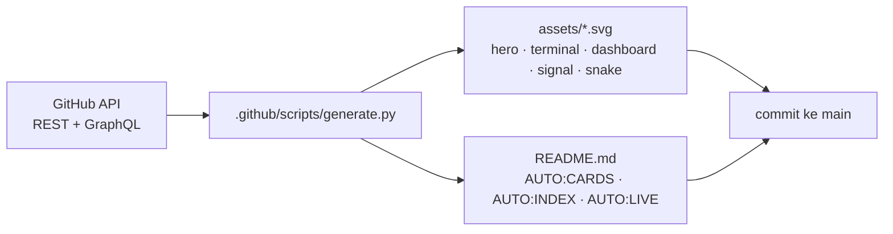

<div align="center">
  
</div>

<p align="center">
  <a href="https://github.com/Ikyletwar?tab=followers"></a>
  
  <a href="https://github.com/Ikyletwar?tab=repositories"></a>
  <a href="#live-endpoints"></a>
  <a href="https://github.com/Ikyletwar/Ikyletwar/actions"></a>
</p>

<br />


## `/whoami --verbose`


```yaml
name: Hizkia Letwar
handle: "@Ikyletwar"
display_name: "Nihongo-Web"
role: "XI TJKT 1 · SMK Negeri 1 Maluku Tengah"
model: [static-first, offline-first, mobile-first, no-build-when-possible]
focus: [web & PWA, android kotlin/compose, school tooling, reverse engineering, prompt-injection research]
signal: "self-updating — assets regenerated daily from the GitHub API"
```

## About Me

Saya Hizkia Letwar, siswa **XI TJKT 1 di SMK Negeri 1 Maluku Tengah** — jurusan Teknik Jaringan Komputer dan Telekomunikasi. Banyak project saya berangkat dari hal yang dekat dengan sekolah dan komunitas: jadwal pelajaran, direktori guru, absensi, pencatatan pelanggaran, inventaris barang, situs kelas, dan prompt AI untuk teman-teman TJKT. Saya lebih suka membangun tool yang benar-benar dipakai daripada sekadar demo yang berhenti di localhost.

Benang merahnya adalah rasa penasaran: bagaimana sebuah sistem bekerja, bagaimana ia gagal, dan bagaimana saya bisa membuatnya lebih berguna. Itu alasan saya masuk ke web apps, PWA offline-first, Android (Kotlin/Compose/Room dan Java), reverse engineering, OSINT, dan prompt-injection research. Saya suka mulai dari problem nyata, bikin versi paling sederhana yang jalan, deploy dulu, lalu perbaiki sampai layak dipakai.

Minat yang paling sering muncul: **bahasa Jepang**, **anime & streaming**, **catur**, **UI premium / dark / glassmorphism**, **AI di browser**, dan **keamanan aplikasi**.

Cara kerja saya sederhana: **statis dulu kalau bisa, offline kalau memungkinkan, mobile-first selalu, backend hanya kalau memang perlu.** Saya nyaman dengan HTML/CSS/JavaScript murni, lalu naik ke PWA, Express/SQLite/Room, sampai native C/NDK kalau projectnya menuntut.

## Signal





<p align="center"><sub>Semua panel di atas dirender dari data publik GitHub — bukan gambar tempelan. Diperbarui otomatis setiap hari oleh <code>.github/workflows/profile.yml</code>.</sub></p>

## Featured Repos

<p align="center"><sub>Pilihan otomatis: repo dengan live demo dan push terbaru. <b>LIVE</b> = GitHub Pages aktif.</sub></p>

<!-- AUTO:CARDS -->
<table>
<tr><td width="50%" align="center" valign="top"><a href="https://github.com/Ikyletwar/nilai-akhir-smk"></a><br><sub><a href="https://github.com/Ikyletwar/nilai-akhir-smk">Repo ↗</a> · <a href="https://ikyletwar.github.io/nilai-akhir-smk/">Live ↗</a></sub></td><td width="50%" align="center" valign="top"><a href="https://github.com/Ikyletwar/nihongo-prompts"></a><br><sub><a href="https://github.com/Ikyletwar/nihongo-prompts">Repo ↗</a> · <a href="https://ikyletwar.github.io/nihongo-prompts/">Live ↗</a></sub></td></tr>
<tr><td width="50%" align="center" valign="top"><a href="https://github.com/Ikyletwar/personal-website-v2"></a><br><sub><a href="https://github.com/Ikyletwar/personal-website-v2">Repo ↗</a> · <a href="https://ikyletwar.github.io/personal-website-v2/">Live ↗</a></sub></td><td width="50%" align="center" valign="top"><a href="https://github.com/Ikyletwar/dih-pinterest-replica"></a><br><sub><a href="https://github.com/Ikyletwar/dih-pinterest-replica">Repo ↗</a> · <a href="https://ikyletwar.github.io/dih-pinterest-replica/">Live ↗</a></sub></td></tr>
<tr><td width="50%" align="center" valign="top"><a href="https://github.com/Ikyletwar/nihongo-quest"></a><br><sub><a href="https://github.com/Ikyletwar/nihongo-quest">Repo ↗</a> · <a href="https://ikyletwar.github.io/nihongo-quest/">Live ↗</a></sub></td><td width="50%" align="center" valign="top"><a href="https://github.com/Ikyletwar/cool-luxe-villa"></a><br><sub><a href="https://github.com/Ikyletwar/cool-luxe-villa">Repo ↗</a> · <a href="https://ikyletwar.github.io/cool-luxe-villa/">Live ↗</a></sub></td></tr>
<tr><td width="50%" align="center" valign="top"><a href="https://github.com/Ikyletwar/exam-smkn1-malteng"></a><br><sub><a href="https://github.com/Ikyletwar/exam-smkn1-malteng">Repo ↗</a></sub></td><td width="50%" align="center" valign="top"><a href="https://github.com/Ikyletwar/MinimapViewer"></a><br><sub><a href="https://github.com/Ikyletwar/MinimapViewer">Repo ↗</a></sub></td></tr>
</table>
<!-- /AUTO:CARDS -->

## Semua Repository

<details>
<summary><b>Seluruh repo publik — buka indeks lengkap</b></summary>

<br />

<!-- AUTO:INDEX -->
| Repo | Bahasa | ★ | Live | Update |
|---|---|---:|---|---|
| [`putra-lordian`](https://github.com/Ikyletwar/putra-lordian) | JavaScript | 0 | [↗](https://ikyletwar.github.io/putra-lordian/) | 32m ago |
| [`netmon`](https://github.com/Ikyletwar/netmon) | HTML | 0 | — | 8h ago |
| [`exam-smkn1-malteng`](https://github.com/Ikyletwar/exam-smkn1-malteng) | Java | 0 | — | 22h ago |
| [`natal-grabber`](https://github.com/Ikyletwar/natal-grabber) | HTML | 0 | — | 1d ago |
| [`animehub`](https://github.com/Ikyletwar/animehub) | JavaScript | 0 | — | 3d ago |
| [`MinimapViewer`](https://github.com/Ikyletwar/MinimapViewer) | Kotlin | 0 | — | 5d ago |
| [`szax-launcher-re`](https://github.com/Ikyletwar/szax-launcher-re) | Python | 0 | — | 5d ago |
| [`nilai-akhir-smk`](https://github.com/Ikyletwar/nilai-akhir-smk) | CSS | 0 | [↗](https://ikyletwar.github.io/nilai-akhir-smk/) | 5d ago |
| [`chess-lan`](https://github.com/Ikyletwar/chess-lan) | HTML | 0 | — | 5d ago |
| [`nihongo-prompts`](https://github.com/Ikyletwar/nihongo-prompts) | HTML | 0 | [↗](https://ikyletwar.github.io/nihongo-prompts/) | 6d ago |
| [`simu-web`](https://github.com/Ikyletwar/simu-web) | HTML | 0 | [↗](https://ikyletwar.github.io/simu-web/) | 6d ago |
| [`personal-website-v2`](https://github.com/Ikyletwar/personal-website-v2) | HTML | 0 | [↗](https://ikyletwar.github.io/personal-website-v2/) | 6d ago |
| [`dih-pinterest-replica`](https://github.com/Ikyletwar/dih-pinterest-replica) | JavaScript | 0 | [↗](https://ikyletwar.github.io/dih-pinterest-replica/) | 6d ago |
| [`nihongo-quest`](https://github.com/Ikyletwar/nihongo-quest) | JavaScript | 0 | [↗](https://ikyletwar.github.io/nihongo-quest/) | 6d ago |
| [`cool-luxe-villa`](https://github.com/Ikyletwar/cool-luxe-villa) | HTML | 0 | [↗](https://ikyletwar.github.io/cool-luxe-villa/) | 6d ago |
| [`scraping-dan-cloningan-ujian-online`](https://github.com/Ikyletwar/scraping-dan-cloningan-ujian-online) | HTML | 0 | [↗](https://ikyletwar.github.io/scraping-dan-cloningan-ujian-online/) | 6d ago |
| [`SimpleMusicPlayer`](https://github.com/Ikyletwar/SimpleMusicPlayer) | Java | 0 | — | 9d ago |
| [`AutoJadwal-SMKN1`](https://github.com/Ikyletwar/AutoJadwal-SMKN1) | HTML | 0 | [↗](https://ikyletwar.github.io/AutoJadwal-SMKN1/) | 11d ago |
| [`tiktok-scraper`](https://github.com/Ikyletwar/tiktok-scraper) | Python | 0 | — | 1mo ago |
| [`TatsumiLoader-MLBB`](https://github.com/Ikyletwar/TatsumiLoader-MLBB) | C | 0 | — | 1mo ago |
| [`jailbreak-prompt-corpus`](https://github.com/Ikyletwar/jailbreak-prompt-corpus) | HTML | 0 | — | 1mo ago |
| [`computerclass`](https://github.com/Ikyletwar/computerclass) | CSS | 0 | [↗](https://ikyletwar.github.io/computerclass/) | 1mo ago |
| [`school-inventory`](https://github.com/Ikyletwar/school-inventory) | JavaScript | 0 | — | 1mo ago |
| [`absensi-late-smpn38`](https://github.com/Ikyletwar/absensi-late-smpn38) | Kotlin | 0 | — | 1mo ago |
| [`rupiahs-hunters`](https://github.com/Ikyletwar/rupiahs-hunters) | HTML | 0 | [↗](https://ikyletwar.github.io/rupiahs-hunters/) | 1mo ago |
| [`absensi-late-smk`](https://github.com/Ikyletwar/absensi-late-smk) | Kotlin | 0 | — | 1mo ago |
| [`Arduino-Kejur1`](https://github.com/Ikyletwar/Arduino-Kejur1) | — | 0 | — | 2mo ago |
| [`zerostream2`](https://github.com/Ikyletwar/zerostream2) | JavaScript | 0 | — | 5mo ago |
| [`zerostream`](https://github.com/Ikyletwar/zerostream) | JavaScript | 0 | — | 5mo ago |
| [`Personal-Website`](https://github.com/Ikyletwar/Personal-Website) | HTML | 0 | [↗](https://ikyletwar.github.io/Personal-Website/) | 5mo ago |
| [`Prompt`](https://github.com/Ikyletwar/Prompt) | — | 0 | — | 5mo ago |
| [`KafeElis`](https://github.com/Ikyletwar/KafeElis) | HTML | 0 | [↗](https://ikyletwar.github.io/KafeElis/) | 6mo ago |
| [`SIRA`](https://github.com/Ikyletwar/SIRA) | HTML | 0 | [↗](https://ikyletwar.github.io/SIRA/) | 7mo ago |
| [`StoryForge-AI`](https://github.com/Ikyletwar/StoryForge-AI) | HTML | 0 | [↗](https://ikyletwar.github.io/StoryForge-AI/) | 7mo ago |
| [`Resep-AI`](https://github.com/Ikyletwar/Resep-AI) | HTML | 0 | [↗](https://ikyletwar.github.io/Resep-AI/) | 7mo ago |
| [`Nihonjin-AI`](https://github.com/Ikyletwar/Nihonjin-AI) | HTML | 0 | [↗](https://ikyletwar.github.io/Nihonjin-AI/) | 7mo ago |
| [`SeLA`](https://github.com/Ikyletwar/SeLA) | HTML | 0 | [↗](https://ikyletwar.github.io/SeLA/) | 7mo ago |
| [`TaskFlow-ToDo`](https://github.com/Ikyletwar/TaskFlow-ToDo) | HTML | 0 | [↗](https://ikyletwar.github.io/TaskFlow-ToDo/) | 7mo ago |
| [`Luxury-ECommerce-UI`](https://github.com/Ikyletwar/Luxury-ECommerce-UI) | HTML | 0 | [↗](https://ikyletwar.github.io/Luxury-ECommerce-UI/) | 8mo ago |
| [`Template-UI-Design-2`](https://github.com/Ikyletwar/Template-UI-Design-2) | HTML | 0 | [↗](https://ikyletwar.github.io/Template-UI-Design-2/) | 8mo ago |
| [`Template-UI-Design`](https://github.com/Ikyletwar/Template-UI-Design) | HTML | 0 | [↗](https://ikyletwar.github.io/Template-UI-Design/) | 8mo ago |
| [`text-encoder-decoder`](https://github.com/Ikyletwar/text-encoder-decoder) | HTML | 0 | [↗](https://ikyletwar.github.io/text-encoder-decoder/) | 8mo ago |
| [`modern-login-ui`](https://github.com/Ikyletwar/modern-login-ui) | HTML | 0 | [↗](https://ikyletwar.github.io/modern-login-ui/) | 8mo ago |
<!-- /AUTO:INDEX -->

</details>

## Live Endpoints

<!-- AUTO:LIVE -->
| Project | Live endpoint | Stack |
|---|---|---|
| [`AutoJadwal-SMKN1`](https://github.com/Ikyletwar/AutoJadwal-SMKN1) | <https://ikyletwar.github.io/AutoJadwal-SMKN1/> | HTML |
| [`computerclass`](https://github.com/Ikyletwar/computerclass) | <https://ikyletwar.github.io/computerclass/> | CSS |
| [`cool-luxe-villa`](https://github.com/Ikyletwar/cool-luxe-villa) | <https://ikyletwar.github.io/cool-luxe-villa/> | HTML |
| [`dih-pinterest-replica`](https://github.com/Ikyletwar/dih-pinterest-replica) | <https://ikyletwar.github.io/dih-pinterest-replica/> | JavaScript |
| [`KafeElis`](https://github.com/Ikyletwar/KafeElis) | <https://ikyletwar.github.io/KafeElis/> | HTML |
| [`Luxury-ECommerce-UI`](https://github.com/Ikyletwar/Luxury-ECommerce-UI) | <https://ikyletwar.github.io/Luxury-ECommerce-UI/> | HTML |
| [`modern-login-ui`](https://github.com/Ikyletwar/modern-login-ui) | <https://ikyletwar.github.io/modern-login-ui/> | HTML |
| [`nihongo-prompts`](https://github.com/Ikyletwar/nihongo-prompts) | <https://ikyletwar.github.io/nihongo-prompts/> | HTML |
| [`nihongo-quest`](https://github.com/Ikyletwar/nihongo-quest) | <https://ikyletwar.github.io/nihongo-quest/> | JavaScript |
| [`Nihonjin-AI`](https://github.com/Ikyletwar/Nihonjin-AI) | <https://ikyletwar.github.io/Nihonjin-AI/> | HTML |
| [`nilai-akhir-smk`](https://github.com/Ikyletwar/nilai-akhir-smk) | <https://ikyletwar.github.io/nilai-akhir-smk/> | CSS |
| [`Personal-Website`](https://github.com/Ikyletwar/Personal-Website) | <https://ikyletwar.github.io/Personal-Website/> | HTML |
| [`personal-website-v2`](https://github.com/Ikyletwar/personal-website-v2) | <https://ikyletwar.github.io/personal-website-v2/> | HTML |
| [`putra-lordian`](https://github.com/Ikyletwar/putra-lordian) | <https://ikyletwar.github.io/putra-lordian/> | JavaScript |
| [`Resep-AI`](https://github.com/Ikyletwar/Resep-AI) | <https://ikyletwar.github.io/Resep-AI/> | HTML |
| [`rupiahs-hunters`](https://github.com/Ikyletwar/rupiahs-hunters) | <https://ikyletwar.github.io/rupiahs-hunters/> | HTML |
| [`scraping-dan-cloningan-ujian-online`](https://github.com/Ikyletwar/scraping-dan-cloningan-ujian-online) | <https://ikyletwar.github.io/scraping-dan-cloningan-ujian-online/> | HTML |
| [`SeLA`](https://github.com/Ikyletwar/SeLA) | <https://ikyletwar.github.io/SeLA/> | HTML |
| [`simu-web`](https://github.com/Ikyletwar/simu-web) | <https://ikyletwar.github.io/simu-web/> | HTML |
| [`SIRA`](https://github.com/Ikyletwar/SIRA) | <https://ikyletwar.github.io/SIRA/> | HTML |
| [`StoryForge-AI`](https://github.com/Ikyletwar/StoryForge-AI) | <https://ikyletwar.github.io/StoryForge-AI/> | HTML |
| [`TaskFlow-ToDo`](https://github.com/Ikyletwar/TaskFlow-ToDo) | <https://ikyletwar.github.io/TaskFlow-ToDo/> | HTML |
| [`Template-UI-Design`](https://github.com/Ikyletwar/Template-UI-Design) | <https://ikyletwar.github.io/Template-UI-Design/> | HTML |
| [`Template-UI-Design-2`](https://github.com/Ikyletwar/Template-UI-Design-2) | <https://ikyletwar.github.io/Template-UI-Design-2/> | HTML |
| [`text-encoder-decoder`](https://github.com/Ikyletwar/text-encoder-decoder) | <https://ikyletwar.github.io/text-encoder-decoder/> | HTML |
<!-- /AUTO:LIVE -->

## Signature Work

| Project | Kenapa penting |
|---|---|
| [`nihongo-quest`](https://github.com/Ikyletwar/nihongo-quest) | Sample end-to-end terbaik: kana/kanji/kosakata/grammar, 8 game, handwriting, offline, tanpa akun. |
| [`TatsumiLoader-MLBB`](https://github.com/Ikyletwar/TatsumiLoader-MLBB) | Codebase NDK modular: overlay, ESP, automation, room intel. |
| [`szax-launcher-re`](https://github.com/Ikyletwar/szax-launcher-re) | Analisis alur lisensi APK, patch keyless, catatan packer, artefak signed. |
| [`chess-lan`](https://github.com/Ikyletwar/chess-lan) | Catur lengkap: bot, lokal, LAN; semua aturan FIDE, mobile-first. |
| [`cool-luxe-villa`](https://github.com/Ikyletwar/cool-luxe-villa) | Three.js realtime, siklus siang/senja/malam 30 detik, single file. |
| [`computerclass`](https://github.com/Ikyletwar/computerclass) | Situs kelas XI TJKT 1: monokrom premium, 29 siswa, jadwal, galeri. |

## Stack & Tools

<p align="center">
  
</p>

| Layer | Details |
|---|---|
| Front-end | HTML, CSS, Vanilla JS, Tailwind, responsive/mobile-first, GitHub Pages, Vercel |
| App model | Static-first, PWA/offline-first, localStorage/Room, backend hanya kalau perlu |
| Android | Kotlin + Compose + Room, Java + Android SDK, NDK/C research |
| AI in browser | Cerebras API, bring-your-own-key SPA, prompt engineering |
| RE / security | radare2, decompiler workflow, dynamic analysis, apktool, mitmproxy |
| Data / automation | Python CLI, JSON/Excel export, scraping, Apps Script analysis |
| Automation | GitHub Actions + Python generator — README ini adalah artefak build |

## Operating Principles

| # | Principle | In practice |
|---:|---|---|
| 1 | **Masalah dulu, solusi kemudian** | Repo berangkat dari problem nyata, bukan tutorial. |
| 2 | **Static before server** | Kalau satu file HTML cukup, ya satu file HTML. |
| 3 | **Offline kalau bisa** | PWA, localStorage, Room, prompt pack statis. |
| 4 | **Deploy cepat, lalu rapikan** | Pages/Vercel dulu, polish belakangan. |
| 5 | **Dokumentasi yang cukup** | README dengan live link, scope, dan limitasi jujur. |
| 6 | **Security with context** | RE & prompt-injection untuk belajar dan evaluasi defensif. |

## Roadmap

```text
NOW   school ops tooling · PWA belajar Jepang · RE writeups · premium vanilla UI
NEXT  README yang lebih tajam · empty-state data · performance pass · Android/Compose depth
RULE  bikin sampai jalan dulu, lalu perbaiki sampai layak dipakai
```

## Contact

<p align="center">
  <a href="https://github.com/Ikyletwar"></a>
  <a href="https://ikyletwar.github.io/personal-website-v2/"></a>
  <a href="https://ikyletwar.github.io/nihongo-quest/"></a>
</p>

---

<details>
<summary><b>⚙️ Bagaimana README ini auto-update?</b></summary>

<br />

README ini adalah **artefak build**, bukan dokumen manual.



- **Trigger:** harian (`cron`), push ke `main`, dan `workflow_dispatch`.
- **Auto-detect:** repo baru, deskripsi, bahasa utama (bytes), stars/forks, GitHub Pages aktif, dan push terakhir.
- **Auto-animate:** SVG memakai animasi native (SMIL) — hidup di ``, tanpa JavaScript.
- **Adaptif:** lebar 100%, palet gelap konsisten, alt text untuk pembaca layar.

</details>

<!-- AUTO:STAMP -->
`last sync 2026-11-10 10:10 UTC`
<!-- /AUTO:STAMP -->


