<p align="center">
  <a href="https://github.com/Ikyletwar">
    
  </a>
</p>

<p align="center">
  
  <a href="https://github.com/Ikyletwar?tab=followers"></a>
  
  
  
</p>

---

## `/whoami --verbose`

```yaml
name: Hizkia Letwar
handle: "@Ikyletwar"
display_name: "Nihongo-Web"
role: "XI TJKT 1 · SMK Negeri 1 Maluku Tengah"
region_context: "Maluku Tengah, Indonesia"
shipping_since: "public project repos active since Mar 2026"
last_public_push: "2026-11-03"
stack_bias: ["static-first", "offline-first", "mobile-first", "no-build-when-possible"]
focus:
  - "web apps & PWA"
  - "Android (Kotlin/Compose/Room, Java, NDK/C)"
  - "school & community tooling"
  - "reverse engineering & prompt-injection research"
bio: "I'm Back."
```

> _“I'm Back.” — GitHub bio_

## About Me

Saya Hizkia Letwar, siswa **XI TJKT 1 di SMK Negeri 1 Maluku Tengah** — jurusan Teknik Jaringan Komputer dan Telekomunikasi. Banyak project saya berangkat dari hal yang dekat dengan sekolah dan komunitas: jadwal pelajaran, direktori guru, absensi, pencatatan pelanggaran, inventaris barang, situs kelas, dan prompt AI untuk teman-teman TJKT. Saya lebih suka membangun tool yang benar-benar dipakai daripada sekadar demo yang berhenti di localhost.

Benang merahnya adalah rasa penasaran: bagaimana sebuah sistem bekerja, bagaimana ia gagal, dan bagaimana saya bisa membuatnya lebih berguna. Itu alasan saya masuk ke web apps, PWA offline-first, Android (Kotlin/Compose/Room dan Java), reverse engineering, OSINT, dan prompt-injection research. Saya suka mulai dari problem nyata, bikin versi paling sederhana yang jalan, deploy dulu, lalu perbaiki sampai layak dipakai.

Minat yang paling sering muncul di repo saya: **bahasa Jepang** (`nihongo-quest`, `nihongo-prompts`, `Nihonjin-AI`), **anime dan platform streaming** (`zerostream`, `zerostream2`), **catur** (`chess-lan`), **UI premium / dark mode / glassmorphism** (`Luxury-ECommerce-UI`, template login/auth), **AI di browser** (`SeLA`, `Resep-AI`, `StoryForge-AI`, `Nihonjin-AI`), dan **keamanan aplikasi** (`jailbreak-prompt-corpus`, `dih-pinterest-replica`, `scraping-dan-cloningan-ujian-online`, `TatsumiLoader-MLBB`).

Cara saya bekerja sederhana: statis dulu kalau bisa, offline kalau memungkinkan, mobile-first selalu, backend hanya kalau memang perlu. Saya nyaman dengan HTML/CSS/JavaScript murni, lalu naik ke PWA, Express/SQLite/Room, sampai native C/NDK kalau projectnya menuntut. Saya tidak terlalu tertarik pada kompleksitas buatan; saya tertarik pada tool yang menyelesaikan masalah, terlihat rapi, dan bisa dites langsung di HP.

Singkatnya: saya seorang pelajar TJKT yang suka membangun, membongkar, lalu membangun lagi — dari aplikasi sekolah, web portofolio, sampai riset keamanan yang terdokumentasi.

## Repo Pulse

<p align="center">
  <picture>
    <source media="(prefers-color-scheme: dark)" srcset="https://raw.githubusercontent.com/Ikyletwar/Ikyletwar/output/repo-pulse-dark.svg" />
    <source media="(prefers-color-scheme: light)" srcset="https://raw.githubusercontent.com/Ikyletwar/Ikyletwar/output/repo-pulse.svg" />
    
  </picture>
</p>

<p align="center"><sub>Concrete snapshot from public repos, excluding this profile repository. Dynamic cards below update themselves.</sub></p>

---

## What I Build

| Lane | Concrete repos | What it proves |
|---|---|---|
| **School & community systems** | `computerclass`, `AutoJadwal-SMKN1`, `SIRA`, `school-inventory`, `absensi-late-smk`, `absensi-late-smpn38`, `nihongo-prompts` | I solve real admin/class workflows: jadwal, guru, absensi, pelanggaran, inventaris, prompt kelas. |
| **PWA & learning apps** | `nihongo-quest`, `SeLA`, `StoryForge-AI`, `Resep-AI`, `Nihonjin-AI`, `nihongo-prompts` | Offline/static-first education tools and AI-in-browser workflows. |
| **Premium UI & storefronts** | `Luxury-ECommerce-UI`, `Template-UI-Design`, `Template-UI-Design-2`, `modern-login-ui`, `KafeElis`, `TaskFlow-ToDo` | Dark/glassmorphism/luxury UI systems with vanilla HTML/CSS/JS. |
| **Native & security research** | `TatsumiLoader-MLBB`, `jailbreak-prompt-corpus`, `dih-pinterest-replica`, `scraping-dan-cloningan-ujian-online`, `TikTok scraper: tiktok-scraper` | Curiosity-driven RE, scraping, prompt-injection corpus, Android/native analysis. |
| **Media & streaming** | `zerostream`, `zerostream2`, `SimpleMusicPlayer`, `cool-luxe-villa` | Realtime web experimentation, anime streaming platform, offline Android player, Three.js villa. |

## Signature Work

| Project | Proof | Read |
|---|---|---|
| [`nihongo-quest`](https://github.com/Ikyletwar/nihongo-quest) | [Live](https://ikyletwar.github.io/nihongo-quest/) · JS · PWA · topics: `pwa`, `japanese`, `offline-first` | Best end-to-end sample: kana/kanji/kosakata/grammar, 8 permainan, handwriting practice, no account, no server. |
| [`personal-website-v2`](https://github.com/Ikyletwar/personal-website-v2) | [Live](https://ikyletwar.github.io/personal-website-v2/) · HTML/CSS/JS · topics: `kinetic-typography`, `portfolio` | Portfolio direction: monochrome premium, kinetic typography, vanilla stack. |
| [`computerclass`](https://github.com/Ikyletwar/computerclass) | [Live](https://ikyletwar.github.io/computerclass/) · CSS/HTML/JS · 41 MB size | Official XI TJKT 1 class site: 29 siswa, galeri, jadwal, music autoplay, profiling. |
| [`AutoJadwal-SMKN1`](https://github.com/Ikyletwar/AutoJadwal-SMKN1) | [Live](https://ikyletwar.github.io/AutoJadwal-SMKN1/) · HTML | School schedule + teacher directory integrated with the school board schedule. |
| [`school-inventory`](https://github.com/Ikyletwar/school-inventory) | Express + vanilla JS | Mobile-first inventory for teachers: pilih lokasi, kelola barang, ekspor CSV. |
| [`absensi-late-smk`](https://github.com/Ikyletwar/absensi-late-smk) / [`absensi-late-smpn38`](https://github.com/Ikyletwar/absensi-late-smpn38) | Kotlin · Compose · Room | Two Android attendance + student-violation apps for SMK N 1 and SMPN 38 Maluku Tengah. |
| [`zerostream2`](https://github.com/Ikyletwar/zerostream2) | JS · WebSocket · SQLite · JWT | Open-source anime streaming platform: realtime, auto scraper, auth, zero-subscription. |
| [`TatsumiLoader-MLBB`](https://github.com/Ikyletwar/TatsumiLoader-MLBB) | C/C++ · NDK · forked once | Native MLBB overlay research: ESP, auto-retri, skill automation, room intel. |
| [`jailbreak-prompt-corpus`](https://github.com/Ikyletwar/jailbreak-prompt-corpus) | HTML/JS/Python | Defensive corpus of jailbreak / prompt-injection prompts for detection and evaluation. |

## Live Endpoints

| Project | URL |
|---|---|
| Portfolio v2 | <https://ikyletwar.github.io/personal-website-v2/> |
| Portfolio v1 | <https://ikyletwar.github.io/Personal-Website/> |
| Nihongo Quest | <https://ikyletwar.github.io/nihongo-quest/> |
| Computerclass XI TJKT 1 | <https://ikyletwar.github.io/computerclass/> |
| AutoJadwal SMKN 1 | <https://ikyletwar.github.io/AutoJadwal-SMKN1/> |
| Nihongo Prompts | <https://ikyletwar.github.io/nihongo-prompts/> |
| Pinterest Replica | <https://ikyletwar.github.io/dih-pinterest-replica/> |
| Ujian Online Clone | <https://ikyletwar.github.io/scraping-dan-cloningan-ujian-online/> |
| SImu Web | <https://ikyletwar.github.io/simu-web/> |

## Repository Signal Board — 35 Project Repos

Semua project publik saya ditampilkan sebagai kartu, bukan sekadar link. Klik kartu untuk membuka repo.

<p align="center">
  <sub><b>Legend:</b> amber border = featured · amber dot = has live demo · gray dot = repo only · accent color = primary language · cards generated from public repo metadata, Nov 2026.</sub>
</p>

<table>
<tr>
<td width="50%" align="center" valign="top"><a href="https://github.com/Ikyletwar/simu-web">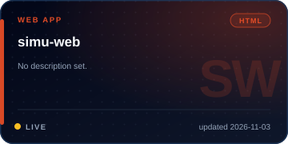</a><br><sub><a href="https://github.com/Ikyletwar/simu-web">Repo ↗</a> · <a href="https://ikyletwar.github.io/simu-web/">Live ↗</a></sub></td><td width="50%" align="center" valign="top"><a href="https://github.com/Ikyletwar/personal-website-v2">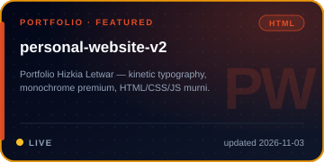</a><br><sub><a href="https://github.com/Ikyletwar/personal-website-v2">Repo ↗</a> · <a href="https://ikyletwar.github.io/personal-website-v2/">Live ↗</a></sub></td>
</tr>

<tr>
<td width="50%" align="center" valign="top"><a href="https://github.com/Ikyletwar/dih-pinterest-replica">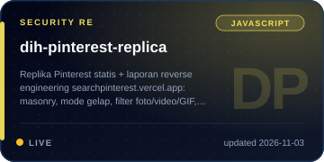</a><br><sub><a href="https://github.com/Ikyletwar/dih-pinterest-replica">Repo ↗</a> · <a href="https://ikyletwar.github.io/dih-pinterest-replica/">Live ↗</a></sub></td><td width="50%" align="center" valign="top"><a href="https://github.com/Ikyletwar/chess-lan">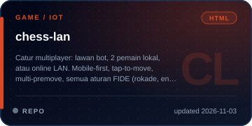</a><br><sub><a href="https://github.com/Ikyletwar/chess-lan">Repo ↗</a></sub></td>
</tr>

<tr>
<td width="50%" align="center" valign="top"><a href="https://github.com/Ikyletwar/nihongo-quest">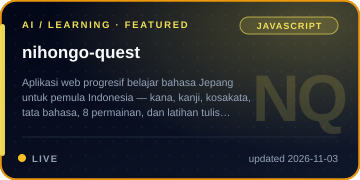</a><br><sub><a href="https://github.com/Ikyletwar/nihongo-quest">Repo ↗</a> · <a href="https://ikyletwar.github.io/nihongo-quest/">Live ↗</a></sub></td><td width="50%" align="center" valign="top"><a href="https://github.com/Ikyletwar/cool-luxe-villa">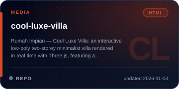</a><br><sub><a href="https://github.com/Ikyletwar/cool-luxe-villa">Repo ↗</a></sub></td>
</tr>

<tr>
<td width="50%" align="center" valign="top"><a href="https://github.com/Ikyletwar/scraping-dan-cloningan-ujian-online">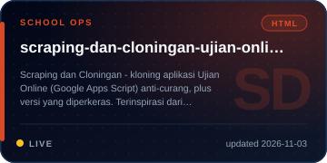</a><br><sub><a href="https://github.com/Ikyletwar/scraping-dan-cloningan-ujian-online">Repo ↗</a> · <a href="https://ikyletwar.github.io/scraping-dan-cloningan-ujian-online/">Live ↗</a></sub></td><td width="50%" align="center" valign="top"><a href="https://github.com/Ikyletwar/Personal-Website">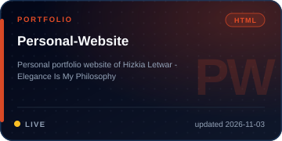</a><br><sub><a href="https://github.com/Ikyletwar/Personal-Website">Repo ↗</a> · <a href="https://ikyletwar.github.io/Personal-Website/">Live ↗</a></sub></td>
</tr>

<tr>
<td width="50%" align="center" valign="top"><a href="https://github.com/Ikyletwar/nihongo-prompts">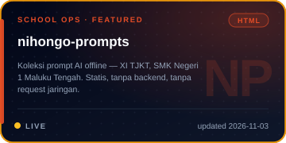</a><br><sub><a href="https://github.com/Ikyletwar/nihongo-prompts">Repo ↗</a> · <a href="https://ikyletwar.github.io/nihongo-prompts/">Live ↗</a></sub></td><td width="50%" align="center" valign="top"><a href="https://github.com/Ikyletwar/SimpleMusicPlayer">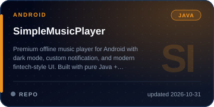</a><br><sub><a href="https://github.com/Ikyletwar/SimpleMusicPlayer">Repo ↗</a></sub></td>
</tr>

<tr>
<td width="50%" align="center" valign="top"><a href="https://github.com/Ikyletwar/AutoJadwal-SMKN1">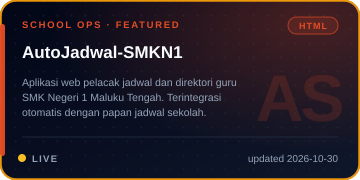</a><br><sub><a href="https://github.com/Ikyletwar/AutoJadwal-SMKN1">Repo ↗</a> · <a href="https://ikyletwar.github.io/AutoJadwal-SMKN1/">Live ↗</a></sub></td><td width="50%" align="center" valign="top"><a href="https://github.com/Ikyletwar/tiktok-scraper">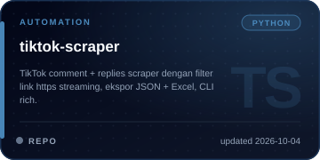</a><br><sub><a href="https://github.com/Ikyletwar/tiktok-scraper">Repo ↗</a></sub></td>
</tr>

<tr>
<td width="50%" align="center" valign="top"><a href="https://github.com/Ikyletwar/TatsumiLoader-MLBB">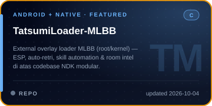</a><br><sub><a href="https://github.com/Ikyletwar/TatsumiLoader-MLBB">Repo ↗</a></sub></td><td width="50%" align="center" valign="top"><a href="https://github.com/Ikyletwar/jailbreak-prompt-corpus">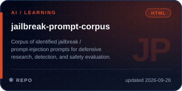</a><br><sub><a href="https://github.com/Ikyletwar/jailbreak-prompt-corpus">Repo ↗</a></sub></td>
</tr>

<tr>
<td width="50%" align="center" valign="top"><a href="https://github.com/Ikyletwar/computerclass">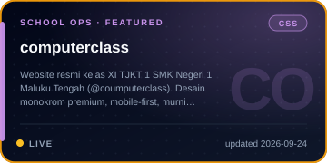</a><br><sub><a href="https://github.com/Ikyletwar/computerclass">Repo ↗</a> · <a href="https://ikyletwar.github.io/computerclass/">Live ↗</a></sub></td><td width="50%" align="center" valign="top"><a href="https://github.com/Ikyletwar/school-inventory">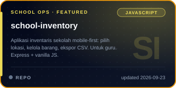</a><br><sub><a href="https://github.com/Ikyletwar/school-inventory">Repo ↗</a></sub></td>
</tr>

<tr>
<td width="50%" align="center" valign="top"><a href="https://github.com/Ikyletwar/absensi-late-smpn38">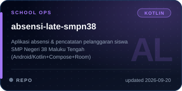</a><br><sub><a href="https://github.com/Ikyletwar/absensi-late-smpn38">Repo ↗</a></sub></td><td width="50%" align="center" valign="top"><a href="https://github.com/Ikyletwar/rupiahs-hunters">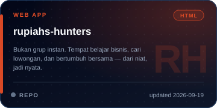</a><br><sub><a href="https://github.com/Ikyletwar/rupiahs-hunters">Repo ↗</a></sub></td>
</tr>

<tr>
<td width="50%" align="center" valign="top"><a href="https://github.com/Ikyletwar/absensi-late-smk">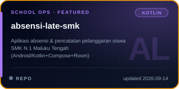</a><br><sub><a href="https://github.com/Ikyletwar/absensi-late-smk">Repo ↗</a></sub></td><td width="50%" align="center" valign="top"><a href="https://github.com/Ikyletwar/Arduino-Kejur1">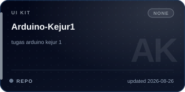</a><br><sub><a href="https://github.com/Ikyletwar/Arduino-Kejur1">Repo ↗</a></sub></td>
</tr>

<tr>
<td width="50%" align="center" valign="top"><a href="https://github.com/Ikyletwar/zerostream2">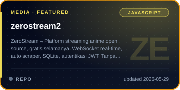</a><br><sub><a href="https://github.com/Ikyletwar/zerostream2">Repo ↗</a></sub></td><td width="50%" align="center" valign="top"><a href="https://github.com/Ikyletwar/zerostream">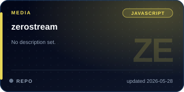</a><br><sub><a href="https://github.com/Ikyletwar/zerostream">Repo ↗</a></sub></td>
</tr>

<tr>
<td width="50%" align="center" valign="top"><a href="https://github.com/Ikyletwar/Prompt">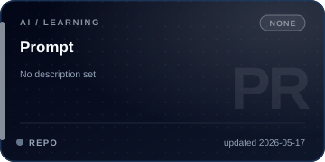</a><br><sub><a href="https://github.com/Ikyletwar/Prompt">Repo ↗</a></sub></td><td width="50%" align="center" valign="top"><a href="https://github.com/Ikyletwar/KafeElis">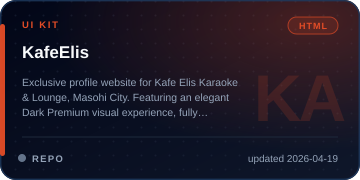</a><br><sub><a href="https://github.com/Ikyletwar/KafeElis">Repo ↗</a></sub></td>
</tr>

<tr>
<td width="50%" align="center" valign="top"><a href="https://github.com/Ikyletwar/SIRA">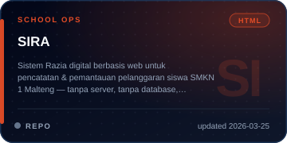</a><br><sub><a href="https://github.com/Ikyletwar/SIRA">Repo ↗</a></sub></td><td width="50%" align="center" valign="top"><a href="https://github.com/Ikyletwar/StoryForge-AI">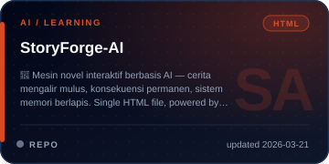</a><br><sub><a href="https://github.com/Ikyletwar/StoryForge-AI">Repo ↗</a></sub></td>
</tr>

<tr>
<td width="50%" align="center" valign="top"><a href="https://github.com/Ikyletwar/Resep-AI">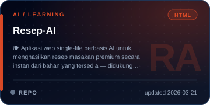</a><br><sub><a href="https://github.com/Ikyletwar/Resep-AI">Repo ↗</a></sub></td><td width="50%" align="center" valign="top"><a href="https://github.com/Ikyletwar/Nihonjin-AI">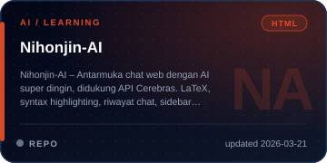</a><br><sub><a href="https://github.com/Ikyletwar/Nihonjin-AI">Repo ↗</a></sub></td>
</tr>

<tr>
<td width="50%" align="center" valign="top"><a href="https://github.com/Ikyletwar/SeLA">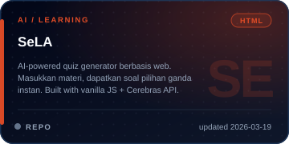</a><br><sub><a href="https://github.com/Ikyletwar/SeLA">Repo ↗</a></sub></td><td width="50%" align="center" valign="top"><a href="https://github.com/Ikyletwar/TaskFlow-ToDo">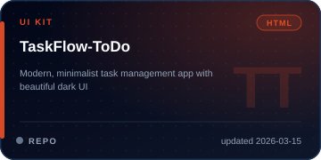</a><br><sub><a href="https://github.com/Ikyletwar/TaskFlow-ToDo">Repo ↗</a></sub></td>
</tr>

<tr>
<td width="50%" align="center" valign="top"><a href="https://github.com/Ikyletwar/Luxury-ECommerce-UI">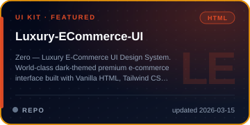</a><br><sub><a href="https://github.com/Ikyletwar/Luxury-ECommerce-UI">Repo ↗</a></sub></td><td width="50%" align="center" valign="top"><a href="https://github.com/Ikyletwar/Template-UI-Design-2">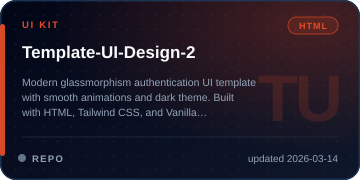</a><br><sub><a href="https://github.com/Ikyletwar/Template-UI-Design-2">Repo ↗</a></sub></td>
</tr>

<tr>
<td width="50%" align="center" valign="top"><a href="https://github.com/Ikyletwar/Template-UI-Design">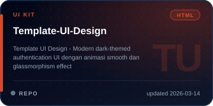</a><br><sub><a href="https://github.com/Ikyletwar/Template-UI-Design">Repo ↗</a></sub></td><td width="50%" align="center" valign="top"><a href="https://github.com/Ikyletwar/text-encoder-decoder">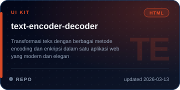</a><br><sub><a href="https://github.com/Ikyletwar/text-encoder-decoder">Repo ↗</a></sub></td>
</tr>

<tr>
<td width="50%" align="center" valign="top"><a href="https://github.com/Ikyletwar/modern-login-ui">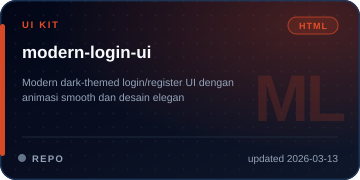</a><br><sub><a href="https://github.com/Ikyletwar/modern-login-ui">Repo ↗</a></sub></td><td width="50%" align="center" valign="top"></td>
</tr>
</table>

<p align="center"><sub>Excludes this profile repository. Dynamic cards in later sections update automatically; these cards are generated from repo metadata and refreshed manually.</sub></p>

---

## Stack & Tools

<p align="center">
  <a href="https://skillicons.dev">
    
  </a>
</p>

| Layer | Details |
|---|---|
| Front-end | HTML, CSS, Vanilla JS, Tailwind CSS, responsive/mobile-first, GitHub Pages, Vercel |
| App model | Static-first, PWA/offline-first, localStorage/Room, no backend unless it earns its place |
| Android | Kotlin + Jetpack Compose + Room, Java + Android SDK, NDK/C research |
| AI in browser | Cerebras API workflows, bring-your-own-key SPAs, prompt engineering |
| RE / security | radare2, Ghidra-style decompilation, Frida-style dynamic analysis, apktool, mitmproxy, Reqable/MT Manager workflow |
| Data / automation | Python CLI, JSON/Excel export, web scraping, Google Apps Script clone analysis |

## GitHub Profile Cards

<p align="center">
  
  
</p>
<p align="center">
  
  
</p>

<p align="center">
  
</p>

## Contribution Snake

<p align="center">
  <picture>
    <source media="(prefers-color-scheme: dark)" srcset="https://raw.githubusercontent.com/Ikyletwar/Ikyletwar/output/github-contribution-grid-snake-dark.svg" />
    <source media="(prefers-color-scheme: light)" srcset="https://raw.githubusercontent.com/Ikyletwar/Ikyletwar/output/github-contribution-grid-snake.svg" />
    
  </picture>
</p>

<p align="center"><sub>Animated SVG snake generated from the public contribution calendar. Static grid fallback:</sub></p>

<details>
<summary>Show static contribution grid</summary>
<p align="center">
  <picture>
    <source media="(prefers-color-scheme: dark)" srcset="https://raw.githubusercontent.com/Ikyletwar/Ikyletwar/output/github-contribution-grid-dark.svg" />
    <source media="(prefers-color-scheme: light)" srcset="https://raw.githubusercontent.com/Ikyletwar/Ikyletwar/output/github-contribution-grid.svg" />
    
  </picture>
</p>
</details>

---

## Operating Principles

| # | Principle | In practice |
|---:|---|---|
| 1 | **Masalah dulu, solusi kemudian** | Most repos start from a real school/community/admin problem, not from a tutorial. |
| 2 | **Static before server** | If a single HTML file can ship it, it ships as HTML/CSS/JS first. |
| 3 | **Offline kalau bisa** | PWA, localStorage, Room, static prompt packs: network is optional when possible. |
| 4 | **Deploy cepat, lalu rapikan** | GitHub Pages/Vercel early; then polish UI, data, and edge cases. |
| 5 | **Dokumentasi yang cukup** | README with live link, concrete scope, and honest limitations. |
| 6 | **Security with context** | RE and prompt-injection work are for learning, defensive evaluation, and authorized assets. |

## Current Signal

```text
Now   : school ops tooling, PWA learning Japanese, RE writeups, premium vanilla UI
Next  : tighter READMEs, better empty-state data, performance pass, more Android/Compose depth
Rule  : bikin sampai jalan dulu, lalu perbaiki sampai layak dipakai
```

## Contact

<p align="center">
  <a href="https://github.com/Ikyletwar"></a>
  <a href="https://ikyletwar.github.io/personal-website-v2/"></a>
  <a href="https://ikyletwar.github.io/nihongo-quest/"></a>
</p>

<p align="center"><sub>No fake metrics. Numbers here come from public repo metadata; dynamic cards may change as GitHub updates.</sub></p>


